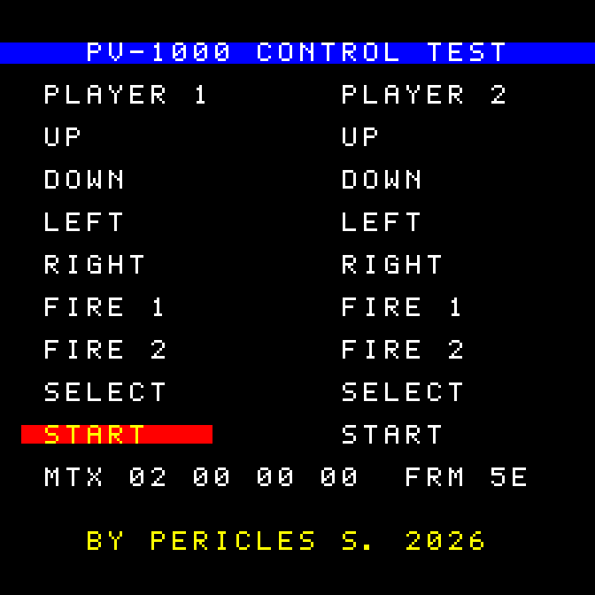

# PV-1000 Control Test

A test ROM for the **Casio PV-1000** (1983) that shows, live, the state of both
controllers. Each label lights up while its button is held, a beep plays (one tone per
controller), and the four raw rows of the joystick matrix are shown in hexadecimal. A frame
counter next to them shows that the program is running.



Useful to check a real console's controllers, an emulator's input mapping, or how the
joystick matrix works. It reads the controllers the same way the commercial games do.

## Download

The ROM is in the [releases](https://github.com/PSGM-Romhacking/pv-1000_control_test_rom/releases),
zipped under its No-Intro-style name:

| File | Size | CRC32 | SHA-1 |
|---|---|---|---|
| `PV-1000 Control Test (World) (Aftermarket) (Unl).bin` | 8 KB | `32c551cf` | `e0d7057f11f81efcad414e692e35b5a5a20cf753` |

Not yet tested on the real console: reports are welcome.

## The screen

| Area | What it shows |
|---|---|
| `PLAYER 1` / `PLAYER 2` | Up, Down, Left, Right, Fire 1, Fire 2, Select, Start: yellow on a red bar while held |
| `MTX` | the 4 rows read from port `0xFD`, the whole byte in hexadecimal (row 0 to 3) |
| `FRM` | a frame counter (hexadecimal); if it stops, the program no longer sees new frames |
| title / credit | white on a blue bar across the top / yellow at the bottom |
| sound | while a button is held: controller 1 on channel 1 (about 380 Hz), controller 2 on channel 2 (about 580 Hz) |

## The joystick matrix

The program writes a row to port `0xFD` (1, 2, 4 or 8) and reads that row's buttons back
from the same port. Controller 1 uses bits 0–1, controller 2 bits 2–3:

| Row (written) | Bit 0 (P1) / bit 2 (P2) | Bit 1 (P1) / bit 3 (P2) |
|---|---|---|
| 0 (`0x01`) | Select | Start |
| 1 (`0x02`) | Down | Right |
| 2 (`0x04`) | Left | Up |
| 3 (`0x08`) | Fire 2 | Fire 1 |

So, for example, `MTX 02 00 00 00` means Start on controller 1 (row 0, bit 1), as in
the screenshot above.

**Bits 4–7 are shown too.** No button uses them, but emulators disagree on what they read:
MAME 0.289 returns bit 7 set (`80` with nothing held), Obentou returns `00`. What the real
console returns is not yet known.

**Fire 1 / Fire 2 are just names.** A switch on the PV-1000 controller swaps its two attack
buttons, so there is no fixed "button 1" ([NESdev Wiki](https://obscure.nesdev.org/wiki/Casio_PV-1000/Controller)).
This ROM follows the MiSTer core (Fire 1 = bit 1 of row 3); MAME calls bit 0 "Button 1", so
there it lights up as FIRE 2.

**The matrix is slow.** On the real console a press takes up to 41 T-states to show after
its row is selected, and up to 147 to go away after the row is deselected. The program
waits about 180 T-states after selecting each row before reading it; emulators read
instantly, so there it makes no difference.

## Building

You need [z80asm](https://www.nongnu.org/z80asm/) (GNU) and `make`:

| Distro | Install |
|---|---|
| Fedora | `sudo dnf install z80asm` |
| Debian / Ubuntu | `sudo apt install z80asm` |
| Arch | `yay -S z80asm` (AUR) |

```sh
make          # build/pv-1000_control_test.bin (+ .sha1)
make check    # also checks the CRC32 against the released version
make dist     # build/pv-1000_control_test.zip, with the ROM under its No-Intro name
```

## Files

| File | Contents |
|---|---|
| `src/control-test.asm` | the program, commented (Z80 assembly) |
| `src/font.asm` | the tile patterns of the font, **generated** by `tools/font.py` |
| `src/font-yellow.asm` | the yellow tiles of the credit line, **generated** by `tools/font.py` |
| `tools/font.py` | the 5×7 font (own design) and how it becomes tiles; `make font` after changing it; `--yellow TEXT` gives the codes of a yellow text |
| `.github/workflows/release.yml` | builds the ROM, checks its CRC32 and attaches the zip to the release on each version tag |

## How it works

- **No BIOS:** the PV-1000 starts running the cartridge at address 0. The header disables
  interrupts, sets the stack and jumps to the program at `0x1C00`. The stack grows down
  from `0xBBFF`, so it never touches the RAM tile patterns at `0xBC00`–`0xBFFF`.
- **Tiles straight from the ROM:** the console reads tile patterns from the cartridge
  (tile *N* at *N* × 32: an unused plane, then red, green and blue). Each character has
  three tiles: its ASCII code (white text), the code + `0x40` (white on a full-height blue
  bar, for the title) and the code + `0x80` (yellow on a red bar). To light a label, the
  program just sets bit 7 of its tiles in the map. The PV-1000 has no palette: the color is
  drawn into each tile, so every color is its own set of tiles. The yellow credit line
  uses the free tiles `0x02`–`0x16`, only for the characters it needs (tile `0x01` holds
  the interrupt vector at `0x0038`).
- **One read per frame:** it waits for a new frame, reads the 4 rows, repaints the labels,
  the hexadecimal row and the frame counter, and sets the beeps. The frame is waited for
  with the interrupt (`IM 1`, `HALT`), as the games do: the interrupt reads bit 0 of port
  `0xFC` (new frame) and acknowledges it by writing port `0xFD`. That flag must be enabled
  first (write 1 to port `0xFC`), as on the real console and in MAME; the MiSTer core sets
  it either way. Polling port `0xFC` instead would lose about one frame in 50 on the MiSTer
  core, which clears the flag on the read and misses it when it is set in the same clock.
- **Sound:** the PV-1000 starts with the sound off. Port `0xFB` = `0x02` turns it on.
  Each channel plays at 8739 Hz / (63 − *n*); *n* = 63 is silent. Controller 1 uses
  channel 1 (*n* = 40) and controller 2 channel 2 (*n* = 48), so both can sound at once.

## References

- NESdev Wiki, *Casio PV-1000* and its ASIC registers (CC0): <https://obscure.nesdev.org/wiki/Casio_PV-1000>
- MAME, `pv1000` driver: <https://github.com/mamedev/mame/blob/master/src/mame/casio/pv1000.cpp>
- MiSTer core by Flandango: <https://github.com/MiSTer-devel/Casio_PV-1000_MiSTer>

## License

[MIT](LICENSE): use it, copy it, change it and include it in your own projects (emulator
test suites included), keeping the copyright notice.
